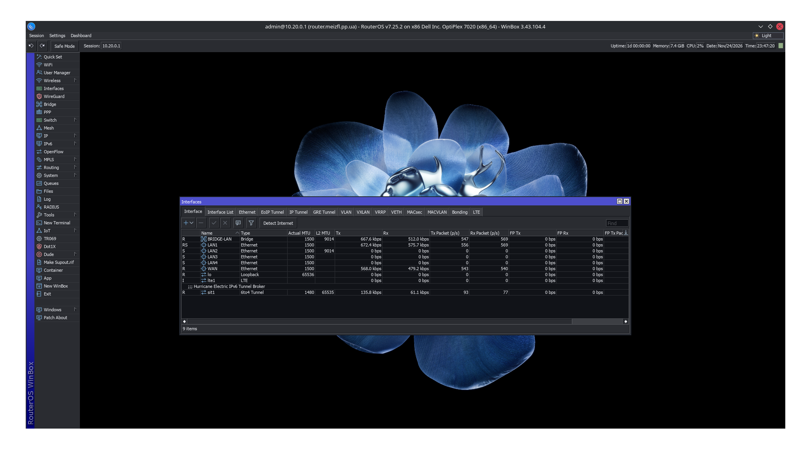
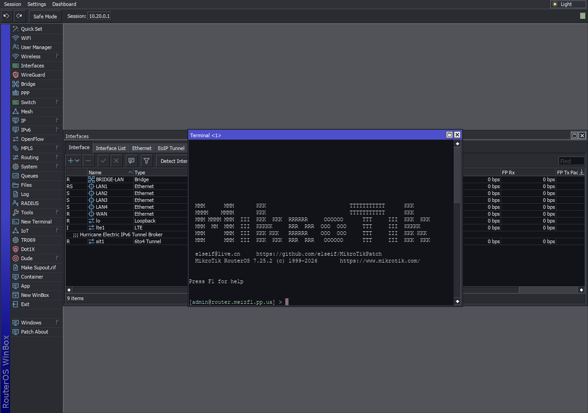
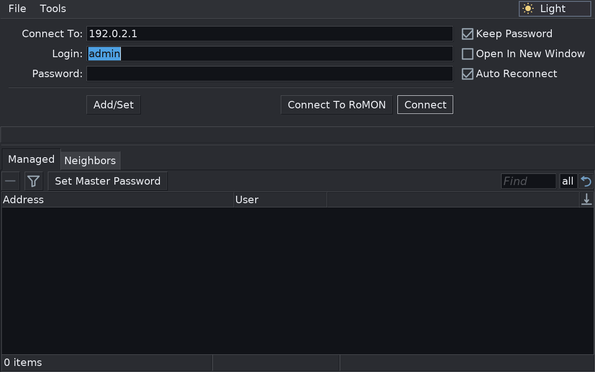

# WinBox Recom

A native Linux and macOS port of WinBox 3 through static recompilation. The supplied
`winbox64.v3.43p10.exe` is translated from x86-64 machine code into C. The original
application logic runs through a custom Windows API compatibility runtime built
with SDL3, Cairo and POSIX APIs. Wine and Proton are not required.

This is an unofficial, experimental compatibility runtime. Login to a real
RouterOS device, module loading, Interfaces, Files and Terminal have been tested.
These checks did not modify the router configuration. The project has not been
validated as a complete replacement for the official WinBox client.

## Downloads

[Download the latest release](https://github.com/meizfl/winbox-recom/releases/tag/v0.2.0-preview.3)

| Platform | Package | Compatibility target |
| --- | --- | --- |
| Linux x86-64 | `winbox3-linux-amd64` | Debian 11+, X11 and native Wayland |
| macOS Intel | `winbox3-macos-x86_64.zip` | macOS 10.14+ |
| macOS Apple Silicon | `winbox3-macos-arm64.zip` | macOS 11.0+, native arm64 without Rosetta |

The Linux executable is fully static and does not depend on the host glibc
version. macOS packages include third-party libraries statically and use Apple's
system libraries and frameworks. They are ad-hoc signed, without Apple
notarization. Deployment targets and native Cocoa startup are checked in CI;
physical machines running macOS 10.14 and 11 still require separate validation.
Checksums are included in `SHA256SUMS`.

## Screenshots

Dark theme, vector icons and a custom wallpaper:



Internal windows and Terminal:



[Light-theme connection window](docs/screenshots/light-login.png).

## Features

- Light and dark themes, with a top-bar switch and a saved preference.
- A shared vector icon set for both themes.
- Blue active-window title bars and consistent internal-window stacking.
- Custom workspace wallpapers in PNG, JPEG or BMP format.
- Native HiDPI/Retina rendering with device-pixel frames and matching input coordinates.
- Cached theme rendering for smoother dragging of windows with many fields.
- Native file dialogs, text clipboard, input carets and resize cursors.
- Native child-process launch from **New WinBox**.

## Running

On Linux, download the executable and run:

```sh
chmod +x winbox3-linux-amd64
./winbox3-linux-amd64
```

On macOS, extract the ZIP for your architecture and open `WinBox Recom.app`.

From a source checkout:

```sh
./run.sh
```

`run.sh` prefers the static Linux package, then `build/linux-check`, then
`build/full`. Set `WINBOX_BINARY` to select an executable explicitly.

### Profiles

Direct launches store user data in:

- Linux: `$XDG_CONFIG_HOME/winbox-recom`, or `~/.config/winbox-recom`.
- macOS: `~/Library/Application Support/WinBox Recom`.

The development `run.sh` uses `build/full/profile`; WinBox data is stored under
its `Mikrotik/Winbox` subdirectory. Existing Windows settings are not imported
automatically. Select a separate profile with:

```sh
./run.sh --profile /path/to/profile
```

Release packages contain no router profiles or login credentials.

### Themes and wallpapers

Use the top-right theme button, or select the initial theme explicitly:

```sh
./run.sh --theme dark
./run.sh --theme light
```

Choose **Settings → Wallpaper → Select wallpaper…** to set a background.
The image fills the workspace while preserving its aspect ratio, with a centered
crop. Tables, Terminal and other internal windows keep their own backgrounds.
Wallpaper colors are preserved in both themes. Supported images are limited to
8192 pixels per side and 32 megapixels.

A copy is saved as `wallpaper.png` in the profile root and loaded on the next
launch. **Settings → Wallpaper → Remove wallpaper** restores the normal
background. Cancelling the picker or selecting an invalid image keeps the
previous wallpaper.

### HiDPI and display backends

GDI renders directly in device pixels; the completed frame is not stretched.
DPI and control sizes follow desktop scaling, with consistent mouse, menu and
internal-window coordinates. A 3000×2000 Wayland output at 200% is covered by an
automated test, including native framebuffer size, sharp glyphs, input,
Backspace, the theme button and popup menus.



Native Wayland is preferred in a Wayland session unless a backend is explicitly
selected. To choose a backend manually:

```sh
SDL_VIDEO_DRIVER=wayland ./run.sh
SDL_VIDEO_DRIVER=x11 ./run.sh
```

Wayland submenus use popup surfaces positioned relative to their parent windows.
The static Linux build presents frames through `wl_shm`, using three buffers
that are not reused until released by the compositor. This does not require EGL
or a dynamically loaded graphics driver. Static Wayland builds disable libdecor;
X11 can be used when server-side window decorations are unavailable.

## Building from source

Requirements: a C11 compiler with `__int128` support (Clang or GCC), CMake,
pkg-config, Python 3, Capstone 5, SDL3, Cairo, FreeType, Fontconfig and iconv.
The current host runtime uses POSIX APIs. macOS uses Cocoa through SDL3; a native
Windows host backend is not implemented.

```sh
python3 -m pip install -r requirements.txt
cmake -S . -B build/full -DWINBOX_FULL_DISCOVERY=ON -DCMAKE_BUILD_TYPE=Release
cmake --build build/full --parallel 2
ctest --test-dir build/full --output-on-failure
./run.sh
```

`winbox-probe` is retained as a diagnostic executable. The legacy
`WINBOX_FULL_DISCOVERY=OFF` mode translates only bootstrap code and a few small
test functions; it does not launch the UI.

### Static Linux package

```sh
podman build -t winbox-static-builder -f packaging/linux-static.Dockerfile .
mkdir -p build/linux-static
podman run --rm -v "$PWD:/src:ro" -v "$PWD/build/linux-static:/out" \
  winbox-static-builder sh /src/packaging/build-linux-static.sh
```

The result is a musl-based static ELF. A desktop display server and installed
system fonts are still needed for graphical use.

### macOS packages

Build natively on the target Mac architecture:

```sh
brew install cmake ninja pkgconf gperf
python3 -m pip install -r requirements.txt meson
bash packaging/build-macos.sh
```

The script defaults to the host architecture. Use `WINBOX_MACOS_ARCH=x86_64` or
`WINBOX_MACOS_ARCH=arm64` explicitly when needed, with a separate build directory
and dependency prefix for each architecture. For example:

```sh
WINBOX_MACOS_ARCH=arm64 bash packaging/build-macos.sh build/macos-arm64
```

The script checks the architecture, deployment target and absence of third-party
dynamic-library dependencies. CI builds and tests Intel and Apple Silicon
packages natively. Dependency versions and SHA256 hashes are pinned in
`packaging/sources.json`.

## Tests and diagnostics

A display-free GUI smoke test can be run with SDL's dummy backend:

```sh
SDL_VIDEO_DRIVER=dummy ./run.sh --smoke-ms 5000 --screenshot /tmp/winbox-login.png
```

The timeout starts when the message loop is ready. Normal launches remain open
until closed by the user. `WINBOX_TRACE=1` enables API tracing;
`WINBOX_INSTRUCTION_LIMIT` sets a diagnostic instruction limit.

Tests cover translated instructions and functions, CRT scanning and time
conversion, threading/TLS, process launch and Windows command-line quoting,
network address layouts, cursor resources, text clipping, vector icons, theme
persistence, wallpaper composition, window stacking and DPI coordinate mapping.
The GUI tests use disposable profiles and do not change a real router.

The local connection smoke test uses a temporary TCP server on `127.0.0.1`.
It checks DNS, address conversion, TCP establishment and shutdown; it does not
implement RouterOS authentication. It is explicitly skipped when local sockets
are unavailable.

`packaging/test-linux-static.sh` runs native SDL presentation tests and CTest in
headless Weston, then checks HiDPI on a separate 3000×2000 output at 200%.
`native-surface-tests` exercises 40 real window-surface frames and two resizes.
The HiDPI-specific test is skipped outside a suitable display and run explicitly
in the scaled Wayland session. Release validation also runs Linux on Debian 11
and the packaged macOS apps through Cocoa in both themes.

For reference rendering, `tools/wine_reference.py` uses a separate display
`:91` so Wine does not appear on the user's desktop.

## How it works

| Component | Purpose |
| --- | --- |
| `tools/pe64.py` | PE parsing, memory image, imports and unwind records |
| `tools/discover64.py` | Instruction discovery, function pointers and jump tables |
| `tools/lift64.py` | Translation into 64 C units, embedded image data and import dispatch |
| `runtime/rt.c` | Guest registers, execution, callbacks and arithmetic |
| `runtime/host.c` | Guest memory, TEB, files, system APIs and PE resources |
| `runtime/crt.c` | CRT functions and formatting used by WinBox |
| `runtime/ui.c` | Original window procedures, messages, input and GDI through SDL/Cairo |
| `runtime/threads.c` | Guest stacks/TEBs, TLS, recursive locks and thread lifecycle |
| `runtime/network.c` | Winsock-to-POSIX sockets, events, interfaces and address conversion |
| `runtime/process.c` | Native process launch and process-handle compatibility |

The approach is static recompilation with a custom runtime, similar to the local
Skyrim-Linux project. Its x86-32 runtime was not copied: this WinBox input is PE64.

Guest addresses remain 64-bit. Memory accesses do not assume host alignment or
byte order. This particular patched input requires guest heap allocations below
4 GiB because a path pointer is read through 32-bit ECX at `0x65b119`. Allocations
also provide zeroed 16-byte headers for another p10 heap check. Freed blocks are
quarantined before reuse to accommodate a known connection-failure handler.

Executable PE sections may also contain mutable data. Writes are allowed, but
instructions on modified pages are compared with their original bytes before
execution. Modified machine code stops with a diagnostic instead of running an
outdated translated body.

Guest execution and host bridges share a recursive VM mutex. Blocking SDL, sleep
and DNS calls release it. This supports guest threading behavior without claiming
that guest code executes in parallel across host cores.

Additional analysis tools:

```sh
python3 tools/analyze_binary.py
python3 tools/discover64.py winbox64.v3.43p10.exe
python3 tools/extract_embedded.py winbox64.v3.43p10.exe
```

Reports are written to `analysis/`, extracted PNG assets to `build/assets/`.
Generated C and intermediate build files are not committed.

## Limitations

Some Windows API bridges implement only the contract needed by the supported
application paths. Windows exceptions, dynamic DLL loading, thread
suspend/resume and DLL thread notifications are incomplete. Some network,
cryptographic, dialog and drag-and-drop paths remain unsupported. Unknown
instructions or APIs stop with their exact address and name.

MAC-address connections, configuration changes and long-running production
sessions have not been comprehensively validated. Generator coverage in
`build/full/gen/coverage.json` is not a measure of application completeness or
proof of full Windows API equivalence.

Tahoma and Courier New provide the closest match to the original UI. These fonts
are not bundled; Fontconfig selects installed substitutes when they are absent.
Font substitutions and the host window manager can affect appearance.

## License

The native runtime, translator and tooling are distributed under GPL-3.0; see
[LICENSE](LICENSE). The original PE input and its embedded resources retain their
original ownership and licensing; the project license does not relicense them.
See [NOTICE](NOTICE) for third-party notices. This project is not affiliated with
or endorsed by MikroTik.
