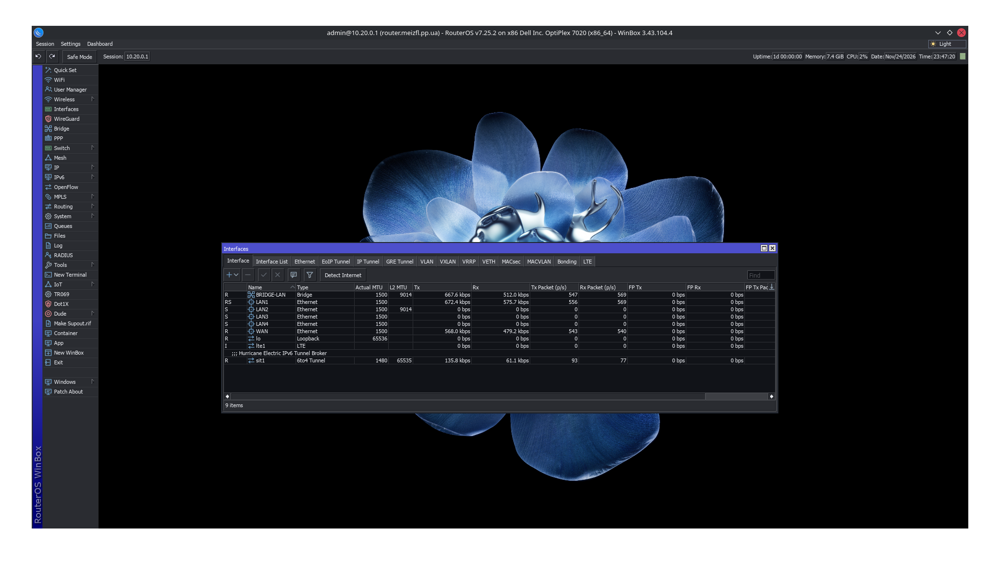
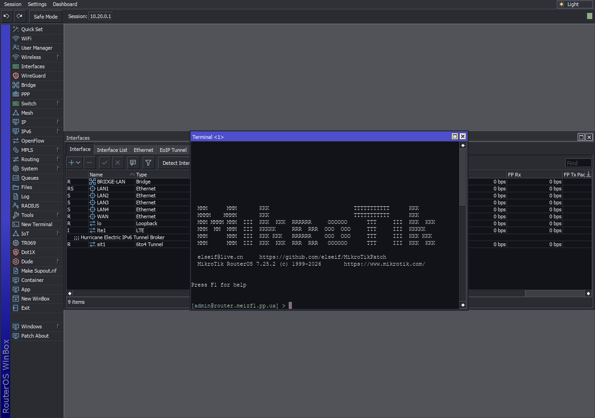
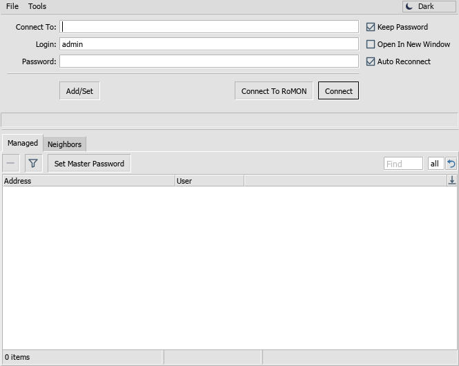

Готовые нативные сборки WinBox Recom для Linux и macOS. Wine и Proton не требуются.

### Что нового

- Светлая и тёмная темы с переключателем в верхней панели и сохранением выбора.
- Новый общий набор векторных иконок, синие заголовки активных окон и аккуратные рамки.
- Обои: **Settings → Wallpaper → Select wallpaper…**. Поддерживаются PNG, JPEG и BMP; картинка сохраняется в профиле. **Remove wallpaper** возвращает обычный фон.
- Исправлены перекрытие, повторная активация и обработка мыши во внутренних окнах.
- Ускорено перетаскивание окон с большим количеством полей: в тестовой сцене с 200 полями сборка кадра ускорилась с 8,5 до 2,5 мс. Добавлен кэш оформления и обработка актуального положения мыши.

### Скачать и запустить

**Linux amd64, Debian 11 и новее:** скачайте `winbox3-linux-amd64`, выполните `chmod +x winbox3-linux-amd64` и запустите файл. Это статический ELF; поддерживаются X11 и нативный Wayland.

**macOS Intel x86_64, целевая версия 10.14+:** распакуйте `winbox3-macos-x86_64.zip` и запустите `WinBox Recom.app`. Сторонние библиотеки включены статически, системные библиотеки и Cocoa предоставляет macOS. Приложение подписано ad-hoc и не нотарифицировано Apple. Сборка и Cocoa smoke-тест выполняются на macOS Intel; проверка на физическом компьютере с macOS 10.14 остаётся необходимой.

Профили и данные входа в пакеты не включены. Пользовательские настройки хранятся отдельно: `~/.config/winbox-recom` на Linux и `~/Library/Application Support/WinBox Recom` на macOS. Другой каталог можно выбрать через `--profile /path/to/profile`.

Контрольные суммы — в `SHA256SUMS`. Исходники доступны по тегу этого релиза. Это предварительный выпуск экспериментального runtime совместимости.

### Скриншоты

Тёмная тема и пользовательские обои:

Работа внутренних окон и терминала:

Окно подключения в светлой теме:

