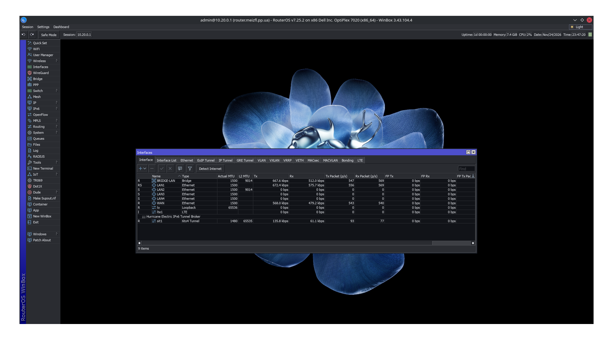
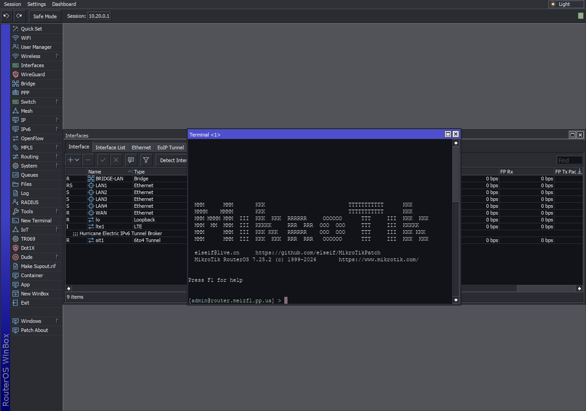
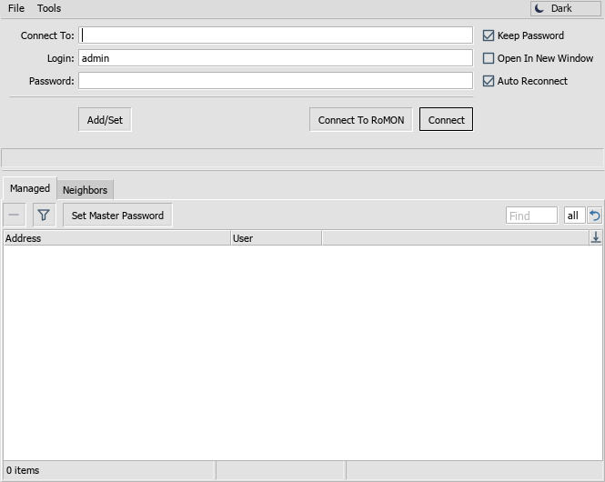

Native WinBox Recom packages for Linux and Intel Macs. Wine and Proton are not required.

### Highlights

- Light and dark themes with a top-bar switch and a saved preference.
- A shared vector icon set, blue active-window title bars and consistent borders.
- Custom PNG, JPEG and BMP wallpapers through **Settings → Wallpaper → Select wallpaper…**. A copy is saved in the profile; **Remove wallpaper** restores the normal background.
- Fixed internal-window stacking, reactivation and mouse hit testing.
- Smoother dragging of windows with many fields through cached theme rendering and coalesced mouse motion. In a 200-field test scene, frame composition improved from 8.5 to 2.5 ms.

Apple Silicon packages were added in **v0.2.0-preview.2**; native device-pixel HiDPI rendering was added in **v0.2.0-preview.3**.

### Packages

- `winbox3-linux-amd64`: fully static Linux x86-64 executable targeting Debian 11+, with X11 and native Wayland support.
- `winbox3-macos-x86_64.zip`: Intel Mac application targeting macOS 10.14+, with statically linked third-party libraries and Apple system frameworks.

On Linux, run `chmod +x winbox3-linux-amd64` and launch the executable. On macOS, extract the ZIP and open `WinBox Recom.app`.

Runtime tests, native Wayland and Debian 11 startup are checked in CI. The packaged Mac app is tested through Cocoa. It is ad-hoc signed and not notarized; physical macOS 10.14 validation remains outstanding.

Checksums are in `SHA256SUMS`. No router profiles or login credentials are included. This is a preview release of an experimental compatibility runtime.

### Screenshots

