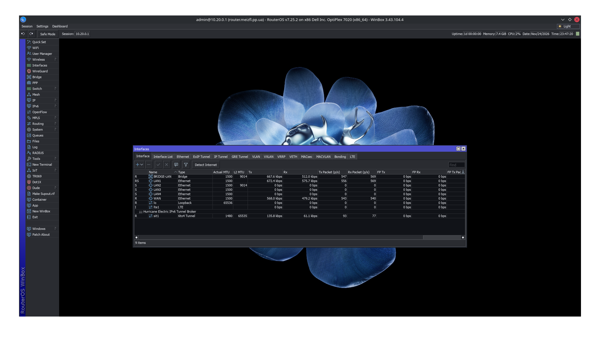
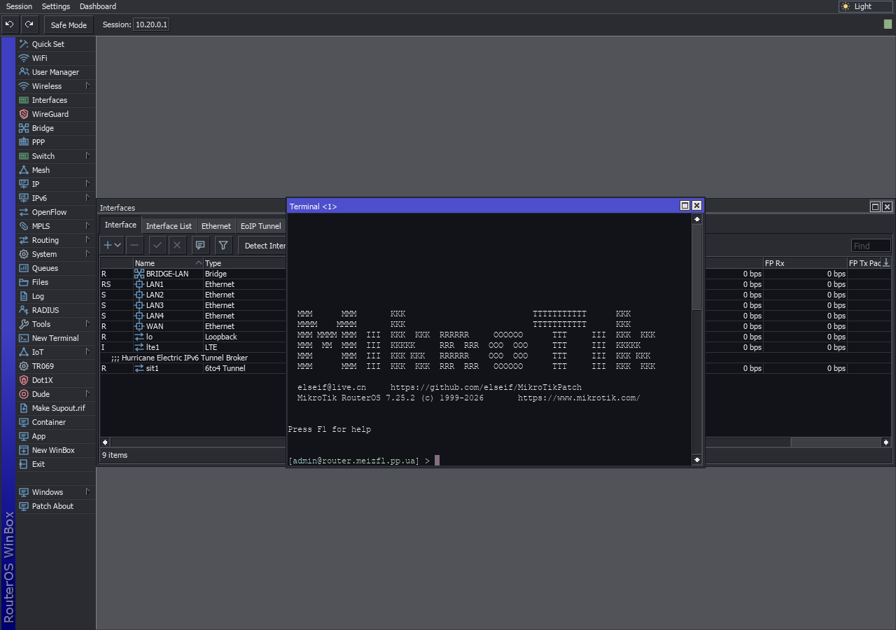
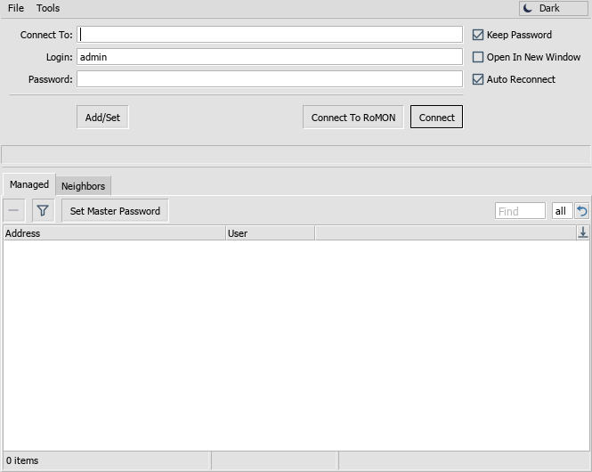

Native WinBox Recom packages for Linux, Intel Macs and Apple Silicon. Wine and Proton are not required.

### Highlights

- Native Apple Silicon arm64 package targeting macOS 11.0+, without Rosetta.
- Light and dark themes with a top-bar switch and a saved preference.
- A shared vector icon set, blue active-window title bars and consistent borders.
- Custom PNG, JPEG and BMP wallpapers through **Settings → Wallpaper → Select wallpaper…**. Use **Remove wallpaper** to restore the normal background.
- Correct internal-window stacking, reactivation and mouse hit testing.
- Cached theme rendering and coalesced mouse motion for smoother window dragging. In a 200-field test scene, frame composition improved from 8.5 to 2.5 ms.

The native device-pixel HiDPI fix was added in **v0.2.0-preview.3**. Use that release or newer for Retina and scaled Wayland displays.

### Packages

| Package | Compatibility target |
| --- | --- |
| `winbox3-linux-amd64` | Linux x86-64, Debian 11+, X11 and native Wayland |
| `winbox3-macos-x86_64.zip` | Intel Macs, macOS 10.14+ |
| `winbox3-macos-arm64.zip` | Apple Silicon, macOS 11.0+ |

On Linux, run `chmod +x winbox3-linux-amd64` and launch the executable. On macOS, extract the ZIP for your architecture and open `WinBox Recom.app`.

Linux is fully static. macOS packages link third-party libraries statically and use Apple's system frameworks. They are ad-hoc signed and not notarized. Architecture, deployment targets, runtime tests and native startup are checked in CI; physical machines running the minimum macOS versions still require separate validation.

Checksums are in `SHA256SUMS`. No router profiles or login credentials are included. This is a preview release of an experimental compatibility runtime.

### Screenshots

