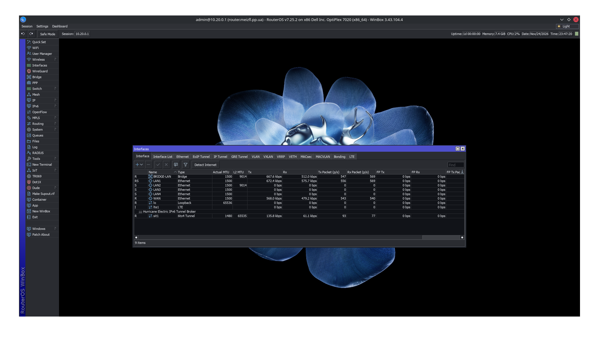
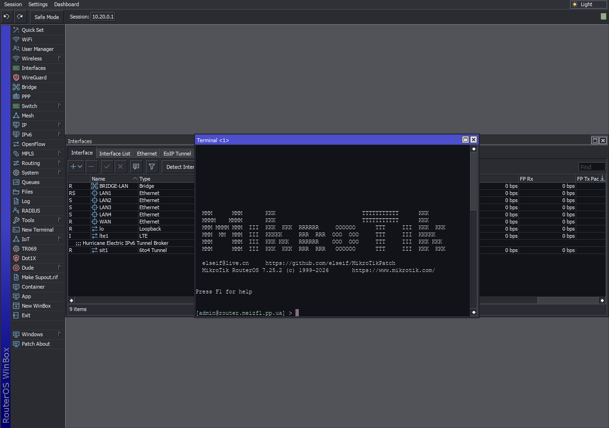
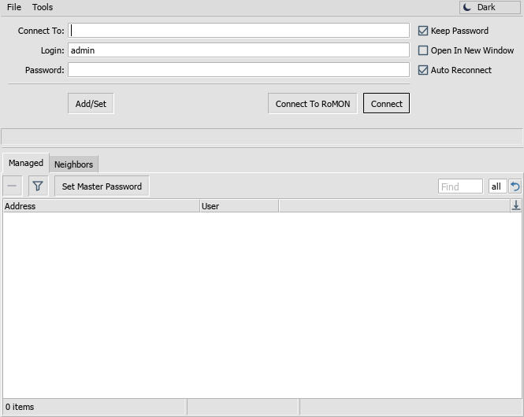
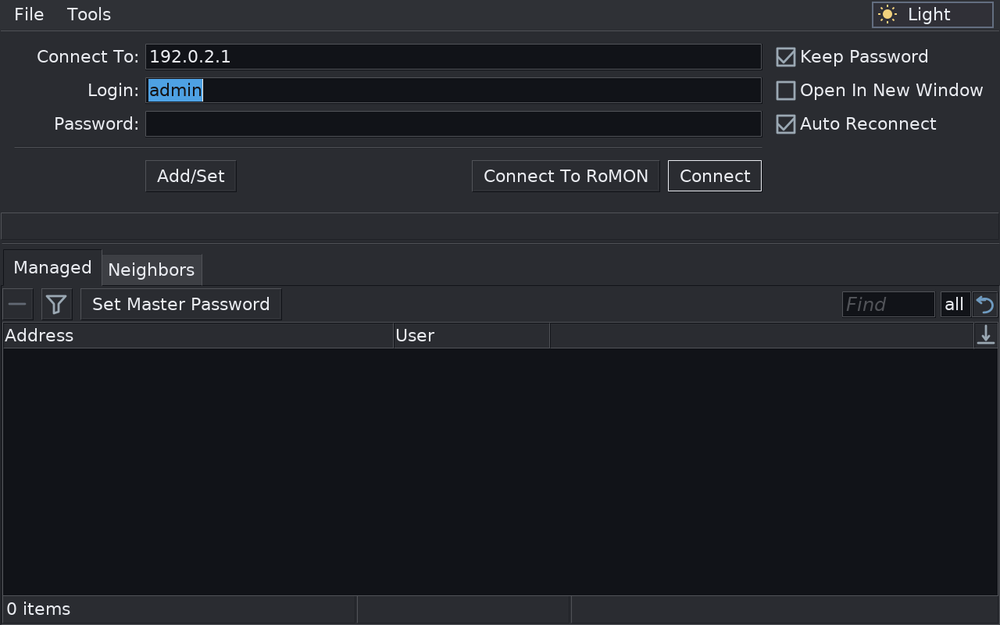

Native WinBox Recom packages for Linux and macOS. No Wine or Proton required.

### What's new

- Light and dark themes with a top-bar switch and a saved preference.
- A shared vector icon set, blue active-window title bars and consistent borders.
- Wallpapers: **Settings → Wallpaper → Select wallpaper…** supports PNG, JPEG and BMP. A copy is saved in your profile. **Remove wallpaper** restores the normal background.
- Fixed internal-window stacking, reactivation and mouse hit testing.
- Smoother dragging of windows with many fields. In a 200-field test scene, frame composition improved from 8.5 to 2.5 ms through cached theme rendering and coalesced mouse motion.
- Native HiDPI/Retina rendering: device-pixel buffers, matching GDI and input coordinates, and sharp text, menus and icons without stretching the completed frame. A 3000×2000 Wayland output at 200% is covered by an automated test.
- Separate native macOS packages for Intel and Apple Silicon.

### Download and run

| Platform | Download | Compatibility target |
| --- | --- | --- |
| Linux amd64 | `winbox3-linux-amd64` | Debian 11+, X11 and native Wayland |
| macOS Intel | `winbox3-macos-x86_64.zip` | macOS 10.14+ |
| macOS Apple Silicon | `winbox3-macos-arm64.zip` | macOS 11.0+, no Rosetta required |

**Linux:** run `chmod +x winbox3-linux-amd64`, then launch the executable. The ELF is fully static.

**macOS:** extract the ZIP for your architecture and open `WinBox Recom.app`. Third-party libraries are linked statically; Apple system libraries and Cocoa are provided by macOS. The app is ad-hoc signed and not notarized by Apple. Both packages are built, tested and launched through Cocoa on their native architecture. Minimum versions are checked in Mach-O and Info.plist; physical machines running macOS 10.14 and 11 still require separate validation.

Packages contain no router profiles or login credentials. Settings are stored separately in `~/.config/winbox-recom` on Linux or `~/Library/Application Support/WinBox Recom` on macOS. Use `--profile /path/to/profile` to select another directory.

Checksums are included in `SHA256SUMS`. Source code is available under this release's tag. This is a preview release of an experimental compatibility runtime.

### Screenshots

Dark theme with a custom wallpaper:

Internal windows and Terminal:

Light-theme connection window:

Native HiDPI rendering at 200%:

### Package validation

Publication requires runtime tests, Debian 11 startup, native Wayland at normal scale and 200%, and packaged-app startup through Cocoa on Intel and Apple Silicon in both themes. Architecture, macOS deployment targets and the absence of third-party dynamic-library dependencies are checked automatically.
